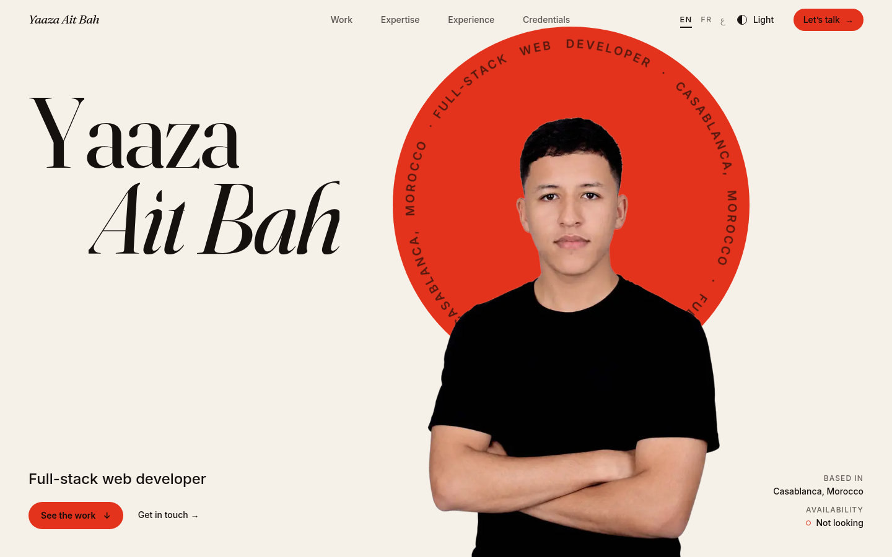
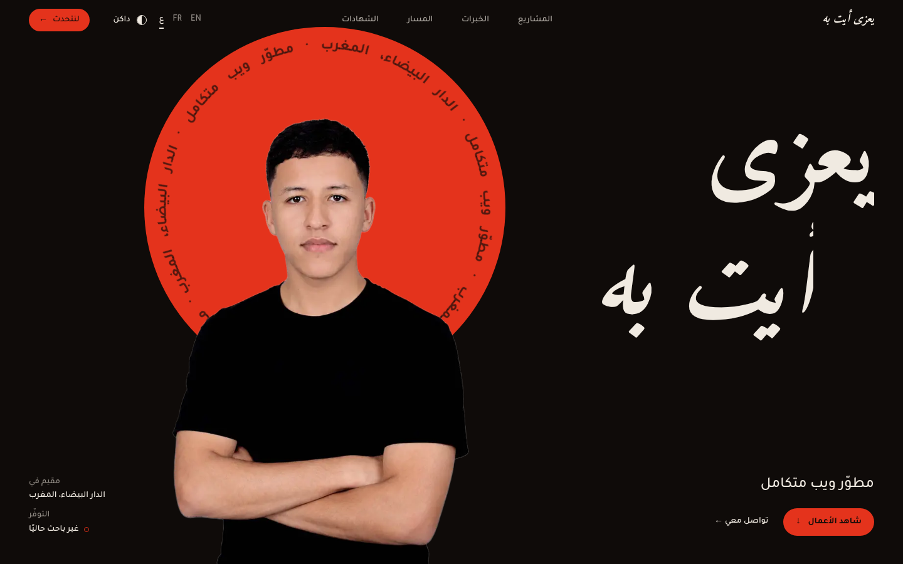
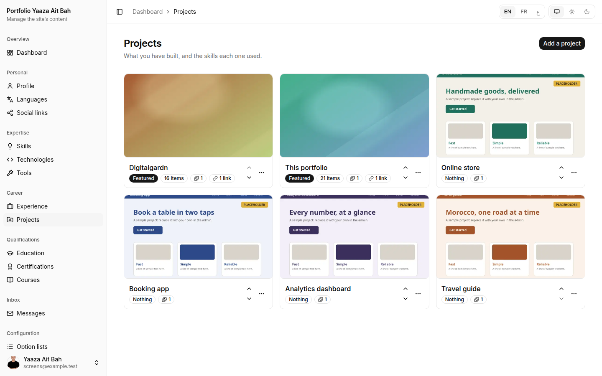

# yaazaaitbah-portfolio

My personal portfolio: a public site in English, French and Arabic, and an admin that manages
every piece of its content. Next.js on the front, Express and MongoDB behind it, all of it in
Docker.

**Live demo:** coming soon.



| Arabic, right to left, dark theme | The admin: projects |
| --- | --- |
|  |  |

## What it does

- **Public site**: one page (work, expertise, experience, credentials, contact) plus a page per
  project. It is rendered on the server from the live API and animated with GSAP and Lenis.
  Light and dark themes are included.
- **Three languages**: English, French and Arabic, with Arabic laid out right to left. English is
  the default, and every piece of content must have it.
- **Admin**: it edits the profile, projects, skills, experience, education, credentials,
  languages, social links and option lists. It has a contact inbox and image uploads. Sign-in
  uses a session cookie, and there is no public registration.
- **SEO**: per-locale metadata, `hreflang`, a sitemap, `robots.txt` and `Person` structured data.

## Stack

| Layer | Tools |
| --- | --- |
| Frontend | Next.js 16 (App Router), React 19, TypeScript, Tailwind CSS 4, shadcn/ui, next-intl, TanStack Query, React Hook Form, GSAP, Lenis |
| Backend | Node.js 24, Express 5, TypeScript, Mongoose 9, Zod, Pino, Helmet |
| Shared | `@portfolio/shared`: the validation rules that both sides of the wire agree on |
| Database | MongoDB 8 |
| Tests | Vitest (unit and integration, with coverage thresholds), Playwright (end to end) |
| Tooling | npm workspaces, ESLint, Prettier, Docker Compose, GitHub Actions |

## Run it locally

You need Docker, and Node.js 24 if you want to run the checks outside the containers.

```bash
cp .env.example .env   # then fill in the values
docker compose up -d
```

| Service  | URL                       |
| -------- | ------------------------- |
| Frontend | http://localhost:3000     |
| Backend  | http://localhost:5000     |
| MongoDB  | mongodb://localhost:27017 |

All three listen on `127.0.0.1` only, because the development database has no authentication.
The source is bind-mounted, so both services reload when a file changes.

The database starts empty. Create the admin account, then load the sample content:

```bash
docker compose exec -e ADMIN_EMAIL=you@example.com -e ADMIN_PASSWORD='at-least-12-characters' \
  backend npm run admin:create

docker compose exec backend npm run db:seed   # replaces every seeded collection
```

The admin is at http://localhost:3000/en/admin.

```bash
docker compose logs -f backend   # follow the logs
docker compose down              # stop; the database and upload volumes survive
```

Full setup, environment variables and everyday commands are in
[`docs/LOCAL-DEVELOPMENT.md`](docs/LOCAL-DEVELOPMENT.md). The production stack and how it is
deployed are in [`docs/PRODUCTION-DEPLOYMENT.md`](docs/PRODUCTION-DEPLOYMENT.md).

## Checks

From the repository root, each command runs across all three packages:

| Command                | Purpose              |
| ---------------------- | -------------------- |
| `npm test`             | Vitest               |
| `npm run lint`         | ESLint               |
| `npm run typecheck`    | TypeScript, no emit  |
| `npm run format:check` | Prettier, check only |
| `npm run build`        | Production build     |

Add `-w <package>` to run one package on its own, for example `npm test -w backend`. CI runs
these commands, then the Playwright suite against the running stack. See
[`docs/CI-CD.md`](docs/CI-CD.md).

## Structure

```text
.
├── shared/              # @portfolio/shared: validation rules and field codes
├── frontend/            # Next.js
│   ├── messages/<locale>/  # translations, one file per namespace
│   ├── e2e/             # Playwright specs against the whole running stack
│   ├── tests/           # mirrors src/
│   └── src/
│       ├── app/[locale] # every route lives under a locale segment
│       ├── components/  # ui/ (shadcn primitives), form/, admin/, layout/, providers/
│       ├── features/    # one folder per entity, plus admin/ (the shell) and site/ (the public site)
│       ├── i18n/        # locale routing, request config, message scoping
│       ├── lib/         # API clients, form resolver, site URLs
│       └── proxy.ts     # locale routing and the admin cookie gate
├── backend/             # Express
│   ├── tests/           # mirrors src/, plus support/ helpers
│   └── src/
│       ├── config/      # environment validation
│       ├── core/        # HTTP contract, error handler, logging, database, storage
│       ├── features/    # one folder per feature (auth, profile, projects, …)
│       ├── seed/        # sample content for a fresh database
│       └── app.ts       # composition root: feature routers mount here
├── docs/                # architecture, API reference, rules
├── scripts/             # deploy, backup and restore, Caddy configuration
├── docker-compose.yml          # development
├── docker-compose.prod.yml     # production
└── docker-compose.staging.yml  # the production build on its own ports
```

## Conventions

- **API responses** always have the shape `{ "code": "...", "details": {} }`. The backend
  returns codes and never translated text. Every failure goes through a single global error
  handler. See [`docs/API-RULES.md`](docs/API-RULES.md) and the
  [endpoint reference](docs/api-endpoints/).
- **Secrets** live in `.env` files, which are never committed. `.env.example` lists the
  variable names only.
- More in [`docs/`](docs/): the architecture, the database model, security, code style and the
  frontend rules.

## License

The code is under the [MIT License](LICENSE).

The personal content is not: the CV text and profile details in
`backend/src/seed/seed-data.ts`, and the screenshots in `docs/screenshots/`, portrait
included. All rights to them are reserved. If you build on this project, replace them with your
own.
